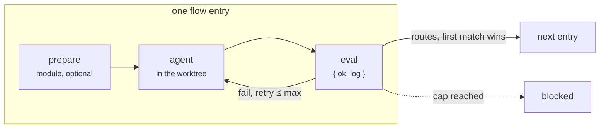

# sous

*Issue in, merged commit out.*

[](https://www.npmjs.com/package/sous-factory)
[](https://github.com/sousfactory/sous/actions/workflows/ci.yml)
[](LICENSE)

**A software factory for coding agents, on your machine.**

`sous` runs your software development flow with coding agents: implement,
review, fix, merge, or any step you write. The flow is a deterministic graph
in YAML, like a GitHub Actions workflow, so the agents do the work and the
graph decides what happens next.


## Why sous

- **Like GitHub Actions, but for agents and local.** Flows are YAML, steps
  are reusable units, routes make a graph. Your flows are yours; the engine
  ships none, the way Actions separates workflows from actions.
- **Deterministic shell, agentic core.** The agent works only in a worktree
  and answers with one JSON envelope. The executor renders the prompt, runs
  the eval, picks the route. It never asks the agent what happens next.
- **Evals judge the work, not the agent's word.** A failed eval retries in
  the same session with the log; after the cap the run stops `blocked`
  instead of guessing.
- **Every visit recorded, every run resumable.** Fix the worktree by hand,
  run the same command, the run continues at the step it left.
- **You own the steps and flows.** `sous init` copies them into your
  repository; from then on they are project code, not configuration.
- **Tracker-agnostic.** GitHub out of the box, `bd` (beads) and local files
  built in, or a tracker module of your own.

## The concept in a nutshell

A **step** is a folder with a `step.yaml`: declared inputs and either a
`prompt` (an agent does the work) or a `module` (TypeScript does it). An
agentic step can add a `prepare`, which runs first and may skip the agent
when there is nothing to do, and an `eval`, which judges the result with
`{ ok, log }`. A failed eval sends the log back to the agent, up to
`maxIterations`. A module runs once.

A **flow** wires steps into a graph. Each entry names a step, its inputs as
expressions over the issue, earlier steps and the last result, the agent
and model, and ordered routes with conditions. `done` and `blocked` are the
only exits; a loop is a route back.



## How a feature gets built

`/sous-plan` turns an issue into a spec and, for a feature, into sub-issues
with acceptance criteria. `sous run feature` then takes the sub-issues one
by one, reviews the whole branch after the last, and squashes it onto the
base branch. `task` is the same flow without the per-item loop.


Every item goes through the pass (`review`) and is refired (`fix`) until
it is clean; the branch as a whole passes once more before it is served.

## Engine, project, UI

| Part | What it is | Where |
| --- | --- | --- |
| **Engine** | Executor, CLI, trackers, sandbox, run record. Ships no steps. | npm `sous-factory` (`packages/core`) |
| **Project** | `sous.yaml`, `flows/`, `steps/`, `skills/`, `prompts/`: the factory of one repository, yours to edit. | `.sous/` in your repository |
| **UI** | `sous ui`, a live run viewer. | bundled with the engine (`packages/ui`) |

The **starter** (`starters/github`) is one project layout for a
GitHub-tracked repository. `sous init` copies it into `.sous/`; it is the
recommended beginning and nothing more. Keep its steps, replace some, or
start from an empty `.sous/` with flows of your own. The engine never
imports the project; it loads your steps, flows and tracker from `.sous/`
at run time.

What `sous init` leaves in a repository:

```
your-project/
├── .claude/skills/sous-plan/     # the planning skill, installed by init
├── specs/<id>-<slug>/spec.md     # written by /sous-plan (specsDir, ../specs from .sous)
└── .sous/
    ├── sous.yaml                 # settings: tracker, baseBranch, branch, lifecycle, dirs
    ├── sous                      # wrapper: npx sous
    ├── package.json              # depends on sous-factory; node_modules/ lives here
    ├── flows/                    # task.yaml, feature.yaml, bench.yaml
    ├── steps/                    # init, next-work, implement, review, fix, verify, merge, …
    ├── skills/                   # vendored skills and sous-plan
    ├── prompts/plan.md           # what /sous-plan follows
    ├── test/                     # the project's step and flow tests
    ├── logs/<id>/                # agent logs            (gitignored)
    ├── runs/<id>/                # session.json, events.jsonl (gitignored)
    └── locks/<id>.lock           # one run per issue; runs on different issues go in parallel
```

## Quick start

Once per machine: Node 22, `gh auth login`, and `claude` or `codex` on the
`PATH`.

**Guided.** Install the setup skill first, then let it do the rest in
Claude Code. It installs, inits, adapts the files with you and fixes what
is off:

```
cp -r <clone of this repo>/skills/sous-setup .claude/skills/   # or download the folder
```

then `/sous-setup`.

**By hand.** From the repository root:

```
npm install -D sous-factory
npx sous init                 # copies the starter into .sous/, installs it, adds /sous-plan
```

`init` prints a checklist: the check commands in
`.sous/steps/verify/eval.ts`, `sous.yaml`, the flows' models and labels,
the `ADAPT` notes in `.sous/prompts/plan.md`. Then:

```
cd .sous && ./sous validate && npx vitest run
./sous run bench <issue>      # a smoke test; touches neither the issue nor the code
```

## Daily use

```
/sous-plan <issue>            # in Claude Code: spec, sub-issues, commit on GO
./sous run task <issue>       # or feature; claims the issue, builds, reviews, merges, closes
./sous status <issue>         # session facts and the timeline
./sous ui                     # the same, live, at http://127.0.0.1:4680
```

A run that cannot go on stops `blocked`: the issue gets a comment saying
where and why, the worktree stays. Fix it by hand and run the same command;
the run continues at that step's eval.


## Your first step

A module step, `steps/greet/`:

```yaml
# step.yaml
name: greet
description: Greet the issue by its title.
inputs:
  name: { description: "who to greet" }
run:
  module: ./run.ts
```

```ts
// run.ts
import type { RunFn } from "sous-factory";

export default (async (_ctx, inputs) => {
  const greeting = `Hello, ${String(inputs["name"])}!`;
  return { summary: greeting, commits: [], output: { greeting } };
}) satisfies RunFn;
```

And a flow that uses it, `flows/hello.yaml`:

```yaml
entry: greet
steps:
  - id: greet
    uses: greet
    with:
      name: ${{ ctx.issue.title }}
    routes:
      - to: done
```

`./sous validate`, then `./sous run hello 42`. The manual's
[how-tos](docs/manual.md#part-iii-how-tos) take it from here: a prompt step
with an eval, a prepare that skips the agent, a new flow.

## Documentation

- [The manual](docs/manual.md): getting started, concepts and reference,
  how-tos.
- The starter's step READMEs, one per folder under `starters/github/steps/`.
- [sous ui](packages/ui/README.md): pages, status mapping, architecture.
- [`skills/sous-setup`](skills/sous-setup/SKILL.md): the guided setup.
- [`skills/sous-migrate`](skills/sous-migrate/SKILL.md): port an existing
  development-loop skill into a flow.
- [Contributing](CONTRIBUTING.md): build, verify, release.

## Maintainers

Built and maintained by [Alexander Heerens](https://github.com/heerens).
Development is sponsored by [Inauditech](https://www.inauditech.com), which
also helps teams adopt `sous`.

## License

[MIT](LICENSE).
