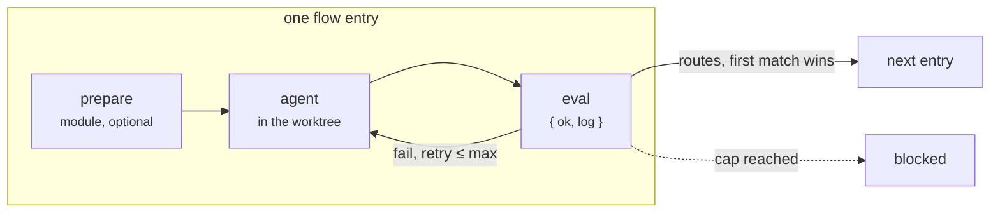

<picture>
  <source media="(prefers-color-scheme: dark)" srcset="docs/images/logo/sous-logo-dark.svg">
  
</picture>

*Agents do the work. The graph decides what happens next.*

[](https://www.npmjs.com/package/sous-factory)
[](https://github.com/sousfactory/sous/actions/workflows/ci.yml)
[](LICENSE)

[Homepage](https://sousfactory.com) · [Manual](docs/manual.md) · [npm](https://www.npmjs.com/package/sous-factory)

# A software factory for coding agents, on your machine.

sous runs your software development flow with coding agents: implement,
review, fix, merge, or any step you write. The flow is a deterministic graph
in YAML, like a GitHub Actions workflow, so the agents do the work and the
graph decides what happens next.

CLI first, with an optional live UI. Runs locally with the `claude` or
`codex` CLI you already have.

```sh
# in Claude Code: spec + sub-issues
> /sous-plan 57

# the rest runs without you
$ ./sous run task 57
$ ./sous status 57

# optional: watch it live
$ ./sous ui
```


The same run in `sous ui` on localhost: implement is done and review is
running, with each step's agent, model and duration. Not a hosted service.

## Why sous

- **Local-first.** Like GitHub Actions, for agents, on your machine. Flows
  are YAML, steps are reusable units, routes make a graph.
- **Agentic core, deterministic shell.** The agent works in a worktree and
  answers with one JSON envelope. The executor renders, evaluates and
  routes; it never asks the agent what happens next.
- **Quality gates.** Evals judge the work, not the agent's word. A failed
  eval retries in the same session with the log; after the cap the run
  stops `blocked` instead of guessing.
- **Multi-model.** Each step names its agent and model, so Claude can
  implement and Codex can review.
- **Resumable.** A blocked run keeps its worktree. Fix it by hand, run the
  same command, and it continues at that step's eval.

Every visit is recorded, every step can be tested alone with fixed inputs,
and the tracker is GitHub, beads, local files or a module of your own. The
[homepage](https://sousfactory.com) has the longer list.

## Quick start

Once per machine: Node 22, `gh auth login`, and `claude` or `codex` on the
`PATH`. Then, from the repository root:

```sh
npm install -D sous-factory
npx sous init                 # copies the starter into .sous/, installs it, adds /sous-plan

cd .sous
./sous validate
./sous run bench <issue>      # smoke test, touches nothing
```

`init` prints a checklist: the check commands in
`.sous/steps/verify/eval.ts`, `sous.yaml`, the flows' models and labels,
the `ADAPT` notes in `.sous/prompts/plan.md`. Prefer a guided setup? Copy
`skills/sous-setup` from this repository into `.claude/skills/`, then
`/sous-setup` installs, inits and adapts the files with you in Claude Code.

Daily use:

```sh
/sous-plan <issue>            # in Claude Code: spec, sub-issues, commit on GO
./sous run feature <issue>    # or task; claims the issue, builds, reviews, merges, closes
./sous status <issue>         # facts + timeline
./sous graph task             # the flow as a diagram
./sous ui                     # live, at http://127.0.0.1:4680
```

A run that cannot go on stops `blocked`: the issue gets a comment saying
where and why, the worktree stays. Fix it by hand and run the same command;
the run continues at that step's eval. The manual's
[first run](docs/manual.md#3-your-first-run) walks through what happens in
between.

## How it works

A **step** is a folder with a `step.yaml`: declared inputs and either a
prompt, where an agent does the work, or a TypeScript module. An agentic
step can add a `prepare`, which decides when the agent runs (always, only
if the eval fails, never), and an `eval`, which judges the result with
`{ ok, log }`.

A **flow** wires steps into a graph. Each entry names its step, its inputs,
the agent and model, and ordered routes with conditions. `done` and
`blocked` are the only exits; a loop is just a route back.

The **executor** owns the loop. The agent sees only a rendered prompt and
its worktree, and hands back a fixed envelope. Judging happens outside the
agent, so a confident agent cannot approve its own work.



**What this buys.** Every decision that routes a run is a condition in YAML
you can read, test and replay. Every judgement call lives in one prompt
with one schema. A flaky agent cannot skip review, cannot merge, and cannot
touch anything outside its worktree, because it was never given those
tools.

This is the starter's `task` flow, shortened. The
[full file](starters/default/flows/task.yaml) also brings main in and
reviews the whole branch before the merge.

```yaml
# .sous/flows/task.yaml, shortened
allowedLabels: [type:task, type:bug]       # which issues this flow accepts
entry: init
steps:
  - id: init                               # a module step: plain TypeScript, no agent
    uses: init
    routes:
      - to: implement

  - id: implement                          # an agent step: the flow names agent and model
    uses: implement
    agent: { kind: claude, model: claude-opus-5-5 }
    with:
      task: ${{ ctx.work.ref + " " + ctx.work.title + "\n\n" + ctx.work.body }}
    routes:
      - to: review

  - id: review
    uses: review
    agent: { kind: claude, model: claude-opus-5-5 }   # or a second opinion: { kind: codex, model: gpt-5.5 }
    with:
      diffRange: ${{ steps.implement.commits[0] + "^..HEAD" }}
      criteria:  ${{ ctx.work.body }}
    routes:                                # ordered, first match wins
      - to: merge
        when: res.ok
      - to: blocked                        # three rounds, then a human
        when: steps.review.visits >= 3
      - to: fix
        else: true

  - id: fix
    uses: fix
    agent: { kind: claude, model: claude-opus-5-5 }
    resume: ${{ steps.fix.session ?? steps.implement.session }}   # continue the agent's session
    with:
      input:     ${{ steps.review.log }}
      inputKind: review
    routes:
      - to: review                         # a loop is just a route back

  - id: merge                              # squash onto main, label, close the issue
    uses: merge
    with:
      baseBranch: main
      mergedLabel: sous:merged
    routes:
      - to: done                           # done and blocked are the only exits
```

Writing a step of your own is a `step.yaml` and a module or a prompt; the
manual's [add a step](docs/manual.md#15-add-a-step) shows a module step, a
prompt step with an eval, and a prepare that decides when the agent runs.

## What's in the box

| Part | What it is | Where |
| --- | --- | --- |
| **Engine** | Executor, CLI, trackers, sandbox, run record. Ships no steps. | npm `sous-factory` (`packages/core`) |
| **Starter** | One project layout for a repository tracked on GitHub or in bd: flows, steps, skills and prompts. `sous init` copies it into `.sous/`. | `starters/default`, shipped with the engine |
| **Project** | `sous.yaml`, `flows/`, `steps/`, `skills/`, `prompts/`: the factory of one repository, yours to edit. | `.sous/` in your repository |
| **UI** | `sous ui`, a live run viewer. | bundled with the engine (`packages/ui`) |

The starter wires Matt Pocock's engineering skills into three flows:
`task` takes one issue through implement, review, fix, sync and merge;
`feature` delivers a parent issue sub-issue by sub-issue, then reviews the
branch as a whole; `bench` is a smoke test that touches neither the issue
nor the code. Its [README](starters/default/README.md) lists every flow,
step and skill. Keep its steps, replace some, or start from an empty
`.sous/` with flows of your own. The engine never imports the project; it
loads your steps, flows and tracker from `.sous/` at run time.

What `sous init` leaves in a repository:

```
your-project/
├── .claude/skills/sous-plan/     # the planning skill, installed by init
├── specs/<id>-<slug>/spec.md     # written by /sous-plan (specsDir, ../specs from .sous)
└── .sous/
    ├── sous.yaml                 # settings: tracker, baseBranch, branch, lifecycle, dirs
    ├── sous                      # wrapper: npx sous
    ├── package.json              # depends on sous-factory; node_modules/ lives here
    ├── flows/                    # task.yaml, feature.yaml, bench.yaml
    ├── steps/                    # init, next-work, implement, review, fix, verify, merge, …
    ├── skills/                   # vendored skills and sous-plan
    ├── prompts/plan.md           # what /sous-plan follows
    ├── test/                     # the project's step and flow tests
    ├── logs/<id>/                # agent logs            (gitignored)
    ├── runs/<id>/                # session.json, events.jsonl (gitignored)
    └── locks/<id>.lock           # one run per issue; runs on different issues go in parallel
        locks/repo.mutex          # the one run working on the shared checkout (merge) at a time
```

## Documentation

- [The manual](docs/manual.md): getting started, concepts and reference,
  how-tos.
- [The starter](starters/default/README.md): its flows and steps, with a
  README per step.
- [sous ui](packages/ui/README.md): pages, status mapping, architecture.
- [`skills/sous-setup`](skills/sous-setup/SKILL.md): the guided setup.
- [`skills/sous-migrate`](skills/sous-migrate/SKILL.md): port an existing
  development-loop skill into a flow.
- [Contributing](CONTRIBUTING.md): build, verify, release.

## Support

- Questions about a step, a flow or a run:
  [Discussions, Q&A](https://github.com/sousfactory/sous/discussions/categories/q-a).
- Bugs and feature requests:
  [issues](https://github.com/sousfactory/sous/issues/new/choose). A bug
  report wants the `sous-factory` version and the output of
  `./sous status <issue>`.
- Security problems: a
  [private advisory](https://github.com/sousfactory/sous/security/advisories/new),
  see [SECURITY.md](SECURITY.md).

One maintainer reads all of it, usually within a few days. The details are
in [SUPPORT.md](SUPPORT.md).

## Maintainers

Built and maintained by [Alexander Heerens](https://github.com/heerens).
Development is sponsored by [Inauditech](https://www.inauditech.com), which
also helps teams adopt `sous`.

## License

[MIT](LICENSE).
