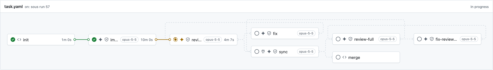
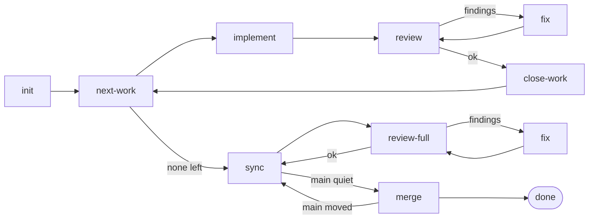
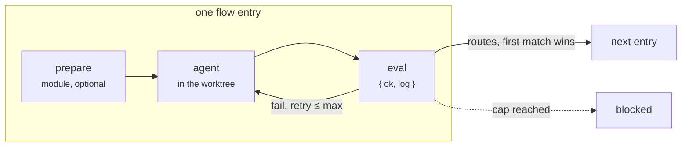

<picture>
  <source media="(prefers-color-scheme: dark)" srcset="docs/images/logo/sous-logo-dark.svg">
  
</picture>

*sous · Issue in, merged commit out*

[](https://www.npmjs.com/package/sous-factory)
[](https://github.com/sousfactory/sous/actions/workflows/ci.yml)
[](LICENSE)

# A software factory for coding agents, on your machine.

sous runs your software development flow with coding agents: implement,
review, fix, merge, or any step you write. The flow is a deterministic graph
in YAML, like a GitHub Actions workflow, so the agents do the work and the
graph decides what happens next.

CLI first, with an optional live UI. Runs locally with the `claude` or
`codex` CLI you already have.

`deterministic flow graph` · `runs locally, in a git worktree` ·
`Claude Code or Codex, per step` · `GitHub, beads or local issues` ·
`open source, MIT`

```sh
npm install -D sous-factory
```

Node 22 · GitHub · npm

```sh
# in Claude Code: spec + sub-issues
> /sous-plan 57

# the rest runs without you
$ ./sous run task 57
$ ./sous status 57

# optional: watch it live
$ ./sous ui
```

## Your development flow is a YAML file

A flow wires reusable steps, the starter's or your own, into a graph, the
way a GitHub Actions workflow wires actions. Each entry names its step, the
agent and model that runs it, its inputs and its routes: first match wins, a
loop is a route back, and `done` and `blocked` are the only exits.

This is `task`, one of the example flows `sous init` copies into your
repository. It is yours: change the steps, the routes and the models, or
write flows that match your own cycle.

```yaml
# .sous/flows/task.yaml, annotated
allowedLabels: [type:task, type:bug]       # which issues this flow accepts
entry: init
steps:
  - id: init                               # a module step: plain TypeScript, no agent
    uses: init
    routes:
      - to: implement

  - id: implement                          # an agent step: the flow names agent and model
    uses: implement
    agent: { kind: claude, model: claude-opus-5-5 }
    with:
      task: ${{ ctx.work.ref + " " + ctx.work.title + "\n\n" + ctx.work.body }}
    routes:
      - to: review

  - id: review
    uses: review
    agent: { kind: claude, model: claude-opus-5-5 }   # or a second opinion: { kind: codex, model: gpt-5.5 }
    with:
      diffRange: ${{ steps.implement.commits[0] + "^..HEAD" }}
      criteria:  ${{ ctx.work.body }}
    routes:                                # ordered, first match wins
      - to: sync
        when: res.ok
      - to: blocked                        # three rounds, then a human
        when: steps.review.visits >= 3
      - to: fix
        else: true

  - id: fix
    uses: fix
    agent: { kind: claude, model: claude-opus-5-5 }
    resume: ${{ steps.fix.session ?? steps.implement.session }}   # continue the agent's session
    with:
      input:     ${{ steps.review.log }}
      inputKind: review
    routes:
      - to: review                         # a loop is just a route back

  - id: sync                               # bring main in; the agent runs only on a conflict
    uses: sync-resolve
    agent: { kind: claude, model: claude-opus-5-5 }
    with:
      baseBranch: main
    routes:
      - to: review-full                    # first time, or main moved
        when: 'steps["review-full"] === undefined || prepared.output.moved || prepared.output.conflict'
      - to: merge
        else: true

  - id: review-full                        # the whole branch against the spec
    uses: review
    agent: { kind: claude, model: claude-opus-5-5 }
    with:
      diffRange: main...HEAD
      criteria:  ${{ ctx.readFile(ctx.specDir + "/spec.md") }}
    routes:
      - to: sync
        when: res.ok
      - to: blocked
        when: 'steps["review-full"].visits >= 4'
      - to: fix-review-full                # a fix step like the one above, back to review-full
        else: true

  - id: merge                              # squash onto main, label, close the issue
    uses: merge
    with:
      baseBranch: main
      mergedLabel: sous:merged
    routes:
      - to: done                           # done and blocked are the only exits
```

The same flow, mid-run, in sous ui on localhost:4680. Not a hosted service:



**Optional UI.** sous is a CLI first; `./sous ui` draws every run as its
flow, live, on localhost. It looks like GitHub Actions and runs on your
machine. Here implement is done and review is running, with each step's
agent, model and duration.

## An agent you can leave alone, because it never decides alone

- **Local-first.** Like GitHub Actions, for agents, on your machine. Flows
  are YAML, steps are reusable units, routes make a graph.
- **Deterministic shell, agentic core.** The agent works in a worktree and
  answers with one JSON envelope. The executor renders, evaluates and
  routes; it never asks the agent what happens next.
- **Quality gates.** Evals judge the work, not the agent's word. A failed
  eval retries in the same session with the log; after the cap the run
  stops blocked instead of guessing.
- **Multi-model.** A second opinion by design: each step names its agent
  and model, so Claude can implement and Codex can review.
- **Testability.** Every step has declared inputs and an output schema, so
  you can run, measure and test it alone with fixed inputs. One big prompt
  or skill never gives you that. `sous-factory/testing` walks whole flows
  over fakes.
- **Observability.** Every visit is recorded: inputs, agent log, eval
  verdict, commits. `sous status` prints the timeline, `sous ui` shows it
  live, and issue labels mirror the run's state.
- **Resumable.** A blocked run keeps its worktree. Fix it by hand, run the
  same command, and it continues at that step's eval.
- **Customizable.** `sous init` copies the steps and flows into your
  repository. From then on they're your code, with their own tests, not
  configuration.
- **Tracker-agnostic.** GitHub out of the box, beads and local files built
  in, or a tracker module of your own.

## The Starter Kit: Proven skills, two flows, yours to change. 

`sous init` copies a working factory (`starters/github`) into `.sous/`: Matt Pocock's
engineering skills wired into two delivery flows. Start with it as it is,
then change any step, prompt or route to match how your team builds
software.

**Flows**

- `task`: one issue. Implement → review ⇄ fix → sync main → full review →
  merge.
- `feature`: a parent issue delivered sub-issue by sub-issue, then reviewed
  as a whole and merged.
- `bench`: a smoke-test flow that touches neither the issue nor the code.

**Skills**

- `implement` and `tdd` write the code.
- `code-review` judges it, and `tdd` fixes what it found.
- `resolving-merge-conflicts` brings main in.
- `to-spec`, `to-tickets` and `grilling` plan the issue with you in
  `/sous-plan`.

### How the Starter `feature` flow works

`/sous-plan` turns an issue into a spec and, for a feature, into sub-issues
with acceptance criteria. `sous run feature` then takes the sub-issues one
by one, reviews the whole branch after the last, and squashes it onto the
base branch.




## Agentic core, deterministic shell

A **step** is a folder with a `step.yaml`: declared inputs and either a
prompt, where an agent does the work, or a TypeScript module. An agentic
step can add a `prepare`, which may skip the agent when there is nothing to
do, and an `eval`, which judges the result.

A **flow** wires steps into a graph. Each entry names its step, its inputs,
the agent and model, and ordered routes with conditions. `done` and
`blocked` are the only exits; a loop is just a route back.

**What this buys.** Every decision that routes a run is a condition in YAML
you can read, test and replay. Every judgement call lives in one prompt
with one schema. A flaky agent cannot skip review, cannot merge, and cannot
touch anything outside its worktree, because it was never given those
tools.

```yaml
# .sous/steps/sync-resolve/step.yaml, one step, annotated
name: sync-resolve
description: Merge main in; the agent runs only on a conflict or failing checks.
inputs:
  baseBranch: { required: true }

prepare:                                   # 1. prepare: TypeScript, runs before the agent
  module: ./prepare.ts                     #    merges main; skips the agent on a clean merge
  output: …                                #    fills {{prepared.*}} in the prompt

run:                                       # 2. prompt: the agent's task, in Markdown
  prompt: prompt.md
  output:                                  #    the JSON the agent must answer with
    type: object
    required: [filesTouched]
    …

eval: ./eval.ts                            # 3. eval: judges the result, returns { ok, log }
maxIterations: 3                           #    a failed eval retries in the same session
```

`prepare.ts`, `prompt.md` and `eval.ts` sit next to `step.yaml` in the
step's folder. One flow entry runs them like this; the executor owns the
loop, the agent sees only a rendered prompt and its worktree, and judging
happens outside the agent, so a confident agent cannot approve its own
work.



Each run writes a session record and an event log; `sous ui` shows them
live. A step's view: its routes, the current visit and the agent log.


### Engine, starter, project, UI

| Part | What it is | Where |
| --- | --- | --- |
| **Engine** | Executor, CLI, trackers, sandbox, run record. Ships no steps. | npm `sous-factory` (`packages/core`) |
| **Starter** | One project layout for a GitHub-tracked repository: the flows, steps, skills and prompts above. `sous init` copies it into `.sous/`. | `starters/github`, shipped with the engine |
| **Project** | `sous.yaml`, `flows/`, `steps/`, `skills/`, `prompts/`: the factory of one repository, yours to edit. | `.sous/` in your repository |
| **UI** | `sous ui`, a live run viewer. | bundled with the engine (`packages/ui`) |

Keep the starter's steps, replace some, or start from an empty `.sous/`
with flows of your own. The engine never imports the project; it loads your
steps, flows and tracker from `.sous/` at run time.

What `sous init` leaves in a repository:

```
your-project/
├── .claude/skills/sous-plan/     # the planning skill, installed by init
├── specs/<id>-<slug>/spec.md     # written by /sous-plan (specsDir, ../specs from .sous)
└── .sous/
    ├── sous.yaml                 # settings: tracker, baseBranch, branch, lifecycle, dirs
    ├── sous                      # wrapper: npx sous
    ├── package.json              # depends on sous-factory; node_modules/ lives here
    ├── flows/                    # task.yaml, feature.yaml, bench.yaml
    ├── steps/                    # init, next-work, implement, review, fix, verify, merge, …
    ├── skills/                   # vendored skills and sous-plan
    ├── prompts/plan.md           # what /sous-plan follows
    ├── test/                     # the project's step and flow tests
    ├── logs/<id>/                # agent logs            (gitignored)
    ├── runs/<id>/                # session.json, events.jsonl (gitignored)
    └── locks/<id>.lock           # one run per issue; runs on different issues go in parallel
        locks/repo.mutex          # the one run working on the shared checkout (merge) at a time
```

## Running in your repository in minutes

Once per machine: Node 22, `gh auth login`, and `claude` or `codex` on the
`PATH`. Then, from the repository root:

```sh
npm install -D sous-factory
npx sous init                 # copies the starter into .sous/, installs it, adds /sous-plan

cd .sous
./sous validate
./sous run bench <issue>      # smoke test, touches nothing
```

`init` prints a checklist: the check commands in
`.sous/steps/verify/eval.ts`, `sous.yaml`, the flows' models and labels,
the `ADAPT` notes in `.sous/prompts/plan.md`. Prefer a guided setup? Copy
`skills/sous-setup` from this repository into `.claude/skills/`, then
`/sous-setup` installs, inits and adapts the files with you in Claude Code.

Daily use:

```sh
/sous-plan <issue>            # in Claude Code: spec, sub-issues, commit on GO
./sous run feature <issue>    # or task; claims the issue, builds, reviews, merges, closes
./sous status <issue>         # facts + timeline
./sous graph task             # the flow as a diagram
./sous ui                     # live, at http://127.0.0.1:4680
```

A run that cannot go on stops `blocked`: the issue gets a comment saying
where and why, the worktree stays. Fix it by hand and run the same command;
the run continues at that step's eval.

A person plans. Agents build in worktrees. A deterministic executor runs
every check. Only what passes is merged.

## Your first step

A module step, `steps/greet/`, and a flow that uses it:

```yaml
# step.yaml
name: greet
description: Greet the issue by its title.
inputs:
  name: { description: "who to greet" }
run:
  module: ./run.ts
```

```ts
// run.ts
import type { RunFn } from "sous-factory";

export default (async (_ctx, inputs) => {
  const greeting = `Hello, ${String(inputs["name"])}!`;
  return { summary: greeting, commits: [], output: { greeting } };
}) satisfies RunFn;
```

```yaml
# flows/hello.yaml
entry: greet
steps:
  - id: greet
    uses: greet
    with:
      name: ${{ ctx.issue.title }}
    routes:
      - to: done
```

`./sous validate`, then `./sous run hello 42`. The manual's
[how-tos](docs/manual.md#part-iii-how-tos) take it from here: a prompt step
with an eval, a prepare that skips the agent, a new flow.

## Documentation

- [The manual](docs/manual.md): getting started, concepts and reference,
  how-tos.
- The starter's step READMEs, one per folder under `starters/github/steps/`.
- [sous ui](packages/ui/README.md): pages, status mapping, architecture.
- [`skills/sous-setup`](skills/sous-setup/SKILL.md): the guided setup.
- [`skills/sous-migrate`](skills/sous-migrate/SKILL.md): port an existing
  development-loop skill into a flow.
- [Contributing](CONTRIBUTING.md): build, verify, release.

## Maintainers

Built and maintained by [Alexander Heerens](https://github.com/heerens).
Development is sponsored by [Inauditech](https://www.inauditech.com), which
also helps teams adopt `sous`.

## License

[MIT](LICENSE).
