# The plan skill, as one flow

One pass of `/sous-plan [#id]` with every case. The numbered boxes are the
steps of `starters/default/prompts/plan.md`, so the diagram and the prompt
change together. The tracker verbs in the prompt (**read the issue**,
**create a child**, …) are defined per tracker in

```mermaid
flowchart TD
  classDef stop fill:#f8e1e1,stroke:#9b2c2c,color:#1f2226
  classDef ask fill:#dfeaf3,stroke:#1f5f8b,color:#1f2226
  classDef write fill:#dff0e2,stroke:#2f6b3a,color:#1f2226
  classDef gate fill:#f6e6da,stroke:#b5551d,color:#1f2226

  S([start: /sous-plan]) --> A0{"1. ISSUE given?"}
  A0 -- no --> A1["1. ask title, problem, kind"]:::ask
  A1 --> A2["1. create the issue with the kind"]:::write
  A2 --> B0
  A0 -- yes --> A3["1. read the issue: title, body, kind, state, comments, children"]
  A3 --> A4{"kind set?"}
  A4 -- no --> A5["1. ask the kind, set the kind"]:::ask
  A5 --> B0
  A4 -- yes --> B0

  B0{"2. preconditions"} -- "issue closed" --> X1["stop: issue is closed"]:::stop
  B0 -- "is a child" --> X2["stop: plan through the parent"]:::stop
  B0 -- "checkout not on base or dirty" --> X3["stop: checkout on base, clean tree"]:::stop
  B0 -- ok --> C0{"3. run state from labels and local worktree"}

  C0 -- "prefix:running" --> X4["stop: a run is in progress; block it or wait"]:::stop
  C0 -- "prefix:blocked, no worktree here" --> X5["stop: blocked on another machine; amend there"]:::stop
  C0 -- "prefix:blocked, worktree here" --> C1["target = worktree on the issue branch"]
  C0 -- "no run" --> C2["target = checkout on the base branch"]
  C1 --> D0
  C2 --> D0

  D0{"4. spec folder in target?"} -- none --> D1["create mode"]
  D0 -- exists --> D2["amend mode: read spec, append only"]
  D1 --> E0
  D2 --> E0

  E0["5. ground rules: read rule files and ADRs; write only spec folder, ADRs, glossary"] --> E1["6. clarify: grill until crisp; amend mode grills the new scope only"]:::ask
  E1 --> E2{"anything new?"}
  E2 -- "no, amend mode: skip the spec, still check children or criteria" --> G0
  E2 -- yes --> E3["6. ADRs and glossary entries, announced first"]:::write
  E3 --> E4["6. optional issue body update, announced first"]:::write
  E4 --> F0

  F0["7. spec: create writes the full file; amend appends an Amendment section"]:::write --> G0{"8. kind?"}

  G0 -- feature --> H0["8.1 list the children"]
  H0 --> H1{"each open child"}
  H1 -- "state label or closed" --> H2["leave as is"]
  H1 -- "not in the child shape" --> H3["8.1 show the rewrite: author's text under What to build, derived criteria, kind task"]:::ask
  H3 --> H4["update the body"]:::write
  H2 --> H5
  H4 --> H5
  H1 -- "in shape" --> H5["8.2 draft the missing slices with edges to kept children"]
  H5 --> H6["8.3 quiz on granularity until approved"]:::ask
  H6 --> H7["8.4 publish blockers first: create a child, add a blocker"]:::write
  H7 --> K0

  G0 -- "task or bug" --> I0{"criteria present and matching the spec?"}
  I0 -- "missing or stale" --> I1["8. draft the checklist from the spec, show it"]:::ask
  I1 --> I2["set the acceptance criteria"]:::write
  I2 --> K0
  I0 -- yes --> K0

  K0{"9. anything to commit in git?"} -- "no: at most issue edits" --> X6["10. report: already planned, child rewrites if any, next command"]:::stop
  K0 -- yes --> K1["9. summary: target, spec path and mode, ADRs, children or criteria, issue edits"]:::gate
  K1 --> K2{"explicit GO?"}:::gate
  K2 -- "changes requested" --> E1
  K2 -- GO --> L0{"target"}
  L0 -- "base checkout" --> L1["9. add spec folder, ADRs, glossary; commit; pull --rebase; push base"]:::write
  L0 -- "worktree" --> L2["9. add the same paths in the worktree; commit on the branch; no push"]:::write
  L1 --> M0
  L2 --> M0
  M0["10. report: target, path, sha, children in order or criteria, next command"] --> Z([end])
```

`starters/default/trackers/<tracker>.md`.

Red boxes stop with a message, blue ones ask the human, green ones write or
commit, orange ones are the gate.

## Cases at a glance

| Run state | Spec | Target | What gets created | Commit | Next command |
| --- | --- | --- | --- | --- | --- |
| no run | none | base checkout | spec, ADRs, children or criteria | commit, rebase, push base | `./sous run <flow> <id>` |
| no run | exists | base checkout | amendment, new children or criteria; nothing if no new scope | same, or none | `./sous run <flow> <id>` |
| blocked, worktree here | exists on the branch | worktree | amendment, new children | commit on the branch, no push | the same run command; re-entry reads the branch |
| blocked, no worktree here | — | — | nothing | none | amend on the machine the blocked comment names |
| running | — | — | nothing | none | block the run or wait |

## Rules that make it idempotent

- **Step 1** reads the children through the tracker, never guessed from the body.
- **Step 6** with no new scope in amend mode skips the spec but not step 8,
  so a hand-filed feature is brought into shape by a rerun with no new scope.
- **Step 8.1** leaves closed children and children carrying a state label
  untouched. A rewrite keeps the author's text under `## What to build` and
  derives the criteria from it; every body edit is shown before it happens.
- **Step 8.2** drafts only the missing slices; kept children become blockers
  where the order needs them.
- **Step 8**, tasks and bugs: the criteria are replaced, never appended, so a
  rerun yields the same body.
- **Step 9** with nothing to commit in git reports and stops before the gate.
  Issue edits made in step 8 were each announced on their own and are listed
  in the report.

## Where the tracker comes in

The prompt names a verb; the sheet says the command. Every sheet defines the
same nine verbs (read the issue, parent of the issue, list the children,
create the issue, set the kind, update the body, create a child, add a
blocker, set the acceptance criteria) and four conventions: how the issue is
written in text (`REF`), where the kind lives, which state labels the run
phase sets, and how a child's parent and blockers are expressed. The shapes
themselves are `starters/default/templates/`: `spec.md` and
`spec-amendment.md` for step 7, `child.md` and `task.md` for step 8, with
the parsing contract of the trackers in their comments. A tracker module of
a project gets a sheet beside it with the same headings.
