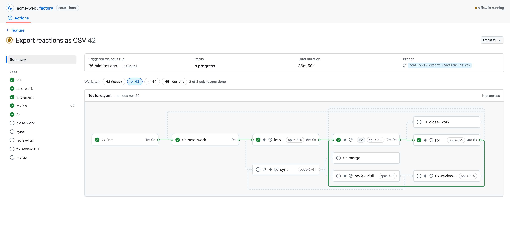
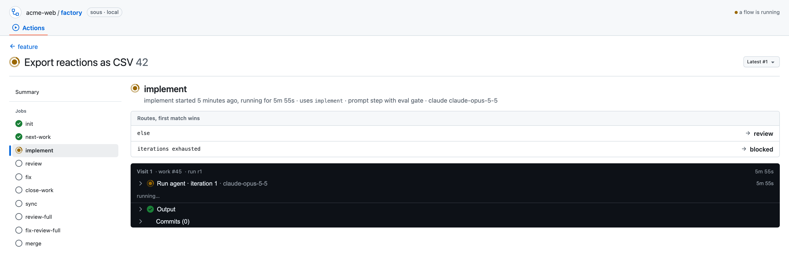

# sous ui

The screen above the pass. Every run drawn as its flow graph, live while
`sous run` writes: which step is working, which passed, where a review sent
the work back. Open a step for its visits, the eval verdict and the agent's
log as it grows. Switch between the run's attempts and its work items, see
the GitHub Actions state of the squash once it landed, and preview any flow
before it ever ran. It reads only the run record on disk; nothing else.



```
./sous ui                 # http://127.0.0.1:4680
./sous ui --port 5000
```

`/runs?flow=<name>` previews a flow's graph, run or not; everything else is
one click from the runs list.

The first start builds the app into `packages/ui/dist/`, which is gitignored. After a
change to `src/`, delete `dist/` or run `npm run build` here. The server
binds to 127.0.0.1 only and has no authentication.

## Pages

| URL | Shows |
| --- | --- |
| `/runs` | One row per issue folder under `runsDir`, newest write first. `?flow=<name>` filters, and draws that flow's graph above its runs as a preview, whether it ran or not: every step queued, every route solid grey. |
| `?flow=<name>&step=<id>` | The preview with a step open below the graph: what it uses, its kind and model, the `description` of its `step.yaml`, and its routes. |
| `/runs/<issue>` | The latest attempt: summary box, work items, flow graph, and under it the steps table: every visit oldest first, with its duration, the agent's summary, its output, a failed eval's log and the next step. Outputs are drawn by shape, since each step has its own schema: an object as fields, a list of objects as a table, a list of values inline, long text folded. Earlier iterations of a visit fold away; the table updates live with the graph. |
| `?attempt=<n>` | An earlier run segment, with the visits of segments 1 to n. |
| `?scope=<work>` | Another work item of a run with sub-issues. |
| `?step=<id>` | The step's job view: routes, visits, agent and eval rows, output, commits. |

A run folder whose `session.json` core cannot load, for example an older
schema, is listed greyed with the loader's message.

The step view, here `implement` mid-run: its routes with the first match
marked, the current visit, the running agent and its output.



## Status mapping

Core stores an `ok` per visit and an outcome per run segment. The view maps
them onto GitHub's states. A step's latest visit decides its colour, and a
badge counts the visits when there were several.

| Step | Shown as |
| --- | --- |
| Latest visit closed with `ok: true` | success |
| Latest visit closed with `ok: false` | failure |
| Latest visit open, and the run is live | in progress |
| Latest visit open, and the run crashed or its process died | failure |
| Latest visit open, and the run was interrupted | cancelled |
| Never visited, run live | queued |
| Never visited, run over | skipped |

| Run | Shown as |
| --- | --- |
| Lock held by a live process | In progress |
| `done` | Success |
| `blocked`, `crashed` | Failure |
| `interrupted` | Cancelled |
| No `run.end` and no live process | Crashed (no end recorded) |

A crashed run whose `run.end` carries the error shows it on the summary
in a red box naming the step it left open, and in that step's visit as an
open "Run crashed" row. The terminal output of `sous run` is not stored, so
the error message is all the UI has; runs from before the field show none.

A run is live while `.sous/locks/<id>.lock` names its issue and the pid
is alive, which is how core decides. Runs on different issues can be live
at once.

The graph is built from `<flowsDir>/<name>.yaml` as the file is now, because
core does not snapshot it per run. A visited step that is no longer in the
file appears as a dashed card with a warning. Routes to `done` and
`blocked` and the implicit exhausted edges are not drawn; the run's outcome
is in the header instead. Routes taken in the run are solid in the colour
of their target, and the others are dashed grey.

Each card shows its step's kind before the name, read from
`<stepsDir>/<uses>/step.yaml`: a sparkle for a prompt step, a code
icon for a module (`run`), a shield for an eval-only step. A tools icon
before the sparkle is a `prepare`: a module that runs before the agent and
decides whether it runs. When the latest visit's prepare skipped the agent,
the sparkle is faded and its tooltip gives prepare's reason. A second shield
after the kind icon is an eval gate: an eval judges the prompt or module,
and a failure retries or routes. Each icon's tooltip says so. A step that
does not load gets no kind icon. In the step view, a visit that ran its
prepare gets a "Run prepare" row before its iterations, saying whether the
agent runs; it opens on the prepared output of the latest visit.

The icons are muted, except the one for the part of an in-progress step
that runs now, which takes the in-progress orange: the tools icon while
prepare runs, the sparkle while the agent call is open, the code icon while the module runs (until its eval
starts), and a shield from the eval's start to its end. The model derives
this as the node's `phase` (`prepare`, `work` or `eval`) from the open
visit's prepare and latest iteration.

In a run with sub-issues, each work item shows the visits in its lane: the
work item a visit operated on. A sub-issue not yet started reads its steps
as queued, and the steps that run on the issue itself after the sub-issues
appear in the issue's lane only. Two exceptions: the steps that ran on the
issue before the first sub-issue was picked are shared by every work item,
and a step that picks sub-issues shows all its visits in the issue's lane,
since it drives the issue's loop; in a sub-issue's lane it shows the visit
that picked that sub-issue (and, in the last one, the visit that found no
more). A route is solid only when its target was visited in the same lane.

## Architecture

| Path | Role |
| --- | --- |
| `server/model.ts` | Pure view model: session, timeline and topology to statuses, edges and details. |
| `server/runs.ts` | Reads run folders, logs and the lock through `sous-factory/read`. Retries a session caught half written. |
| `server/watch.ts` | Change feed: `fs.watch` on `runs/`, `logs/` and the lock, debounced per issue, with mtime polling as fallback and a lock liveness poll. |
| `server/http.ts` | `node:http`: `/api/runs`, `/api/runs/<issue>`, `/api/runs/<issue>/logs/<name>?from=`, `/api/flows/<name>` (the preview), `/api/events` (SSE), and the built app. |
| `server/main.ts` | `sous ui`; core's CLI loads it by path, so core does not depend on this package. |
| `src/` | React with Primer React components, Octicons and Tailwind utilities. The graph uses React Flow at a fixed zoom with a dagre layout. |

The browser opens one EventSource. Each change event names an issue, or
`null` for the lock or the set of runs, and the visible views refetch. An
open agent log fetches only the bytes after its last offset. Logs are served
from `logs/<issue>/` by plain file name only. A visit's log name is the file
name of the `logPath` its events recorded ([manual, chapter 8 and 11](../../docs/manual.md)), so current
`<spanId>-<scope>-<step>-<n>.log` names and the `<step>-<n>.log` names of older
runs both resolve; only an older run's call still in flight, with no path
recorded yet, falls back to `<step>-<n>.log`.

## Development

```
npm run dev           # Vite on :5173, proxies /api to a running sous ui (SOUS_UI_API overrides)
npm run build
npm test              # or from the repo root: npx vitest run --project ui
npm run typecheck
```

Tests are Vitest only. Server tests build sessions and event logs in
temporary project folders. Browser components run under jsdom.
