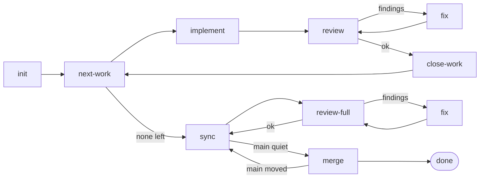

# sous: the default starter

**The most popular dev skills, run in a deterministic flow.**

This folder is a project's factory: the `.sous/` that `sous init` copies
into a repository tracked on GitHub or in bd. It wires Matt Pocock's engineering
skills into flows the `sous` engine runs without a human: `implement` and
`tdd` write the code, `code-review` judges it, `tdd` again fixes what the
review found, `resolving-merge-conflicts` brings the base branch in, and
`to-spec`, `to-tickets` and `grilling` turn an idea into a spec and
sub-issues during `/sous-plan`. The skills do the craft. The flow decides
what happens next: routes are conditions in YAML, evals are code, review
rounds and retries are capped, and the only exits are `done` and `blocked`.

Everything here is yours to edit. Keep the steps, replace some, or write
flows of your own; the engine (`sous-factory`) loads whatever `.sous/`
holds.

## What's in the box

Three flows:

| Flow | Accepts | What it does |
| --- | --- | --- |
| `task` | `type:task`, `type:bug` | One issue: init → implement → review ⇄ fix → sync → review-full ⇄ fix → merge. |
| `feature` | `type:feature` | A parent issue delivered sub-issue by sub-issue (next-work → implement → review ⇄ fix → close-work, repeated), then synced, reviewed as a whole and merged. |
| `bench` | any issue | A smoke test: one module step, one agent step, nothing committed, the issue untouched. |

`feature` in one picture: `/sous-plan` turns the parent issue into a spec
and sub-issues with acceptance criteria; the flow takes the sub-issues one
by one, reviews the whole branch after the last, and squashes it onto the
base branch.




Eleven steps, each with its own `README.md`:

| Step | Kind | Does |
| --- | --- | --- |
| `init` | module | Checks the issue is open and the worktree is on the run's branch. |
| `next-work` | module | Puts the next open child with no open blockers on the bench. |
| `implement` | prompt | Implements the work item following the `implement` and `tdd` skills, commits. |
| `review` | prompt | Judges the diff cold and read-only against the criteria, following `code-review`. |
| `fix` | prompt | Addresses blocking findings or a failed verification, commits. |
| `verify` | eval-only | Runs the project's checks from `steps/verify/eval.ts`; the eval of `implement`, `fix` and `sync-resolve`. |
| `close-work` | module | Comments the commits on the sub-issue, closes it, marks the work done. |
| `sync-resolve` | prompt with prepare | Merges the base branch in; the agent runs only on a conflict or failing checks. |
| `merge` | module | Squashes the branch onto the base branch, cleans up, labels and comments. |
| `hello-world`, `tell-a-joke` | module, prompt | The bench. |

Plus `skills/` (the vendored skills and `sous-plan`, see
`skills/VENDORED.md`), `prompts/plan.md` (what `/sous-plan` follows),
`sous.yaml` (settings) and `test/` (the flows and steps walked through the
engine over fakes: `npx vitest run`).

## Install and use

It arrives with the engine:

```
npm install -D sous-factory
npx sous init                 # copies this folder into .sous/, installs it, adds /sous-plan
```

or, guided, with the `sous-setup` skill from the
[sous repository](https://github.com/sousfactory/sous/tree/main/skills/sous-setup)
and `/sous-setup` in Claude Code. Four things are the project's to set:

1. `steps/verify/eval.ts`: `BASE_BRANCH` and the `CHECKS` to run. Until the
   list is filled, every verify passes with a `WARN` in the log.
2. `sous.yaml`: tracker (`github` or `beads`), `baseBranch`, the branch
   template, `lifecycle`.
3. The flows: the agent and model per step, `allowedLabels`; on GitHub,
   create the `type:task`, `type:bug` and `type:feature` labels (bd derives
   them from the bead type).
4. `prompts/plan.md`: follow its `ADAPT` notes. It speaks to the tracker
   through `trackers/<tracker>.md` (`github`, `beads`, `local`); a tracker
   module of your own needs a sheet beside it.

Then:

```
./sous validate                   # every flow and step
npx vitest run                    # the flows over fakes
./sous run bench <issue>          # smoke test
/sous-plan <issue>                # in Claude Code: spec and sub-issues
./sous run task <issue>           # or feature; status and ui to follow
```

The [manual](https://github.com/sousfactory/sous/blob/main/docs/manual.md)
covers the rest: [getting started](https://github.com/sousfactory/sous/blob/main/docs/manual.md#part-i-getting-started)
and the [how-tos](https://github.com/sousfactory/sous/blob/main/docs/manual.md#part-iii-how-tos)
for changing checks, models, steps, flows, the plan phase and the tracker.

## This project

<!-- replace: what this project's flows and checks are -->
<!-- replace: which steps were changed or added, and why -->
<!-- replace: how to run and watch a run here -->
